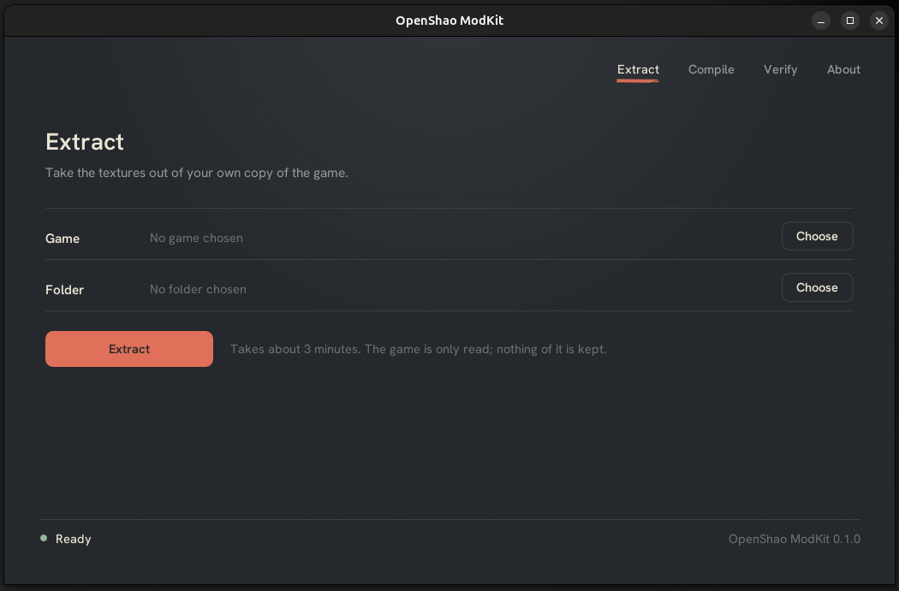

# OpenShao ModKit

Extracts the textures of Mortal Kombat: Shaolin Monks from your own copy of the game and compiles edited pictures into a texture pack (`.ostp`)
that [OpenShao](https://github.com/OAleex/OpenShao) installs from its Mods page. It reads the game and stores nothing of it.



## The flow

1. **Extract** the game's textures to a folder of PNG pictures: `modkit extract <game> <folder>`.
   `<game>` is the disc image (`.iso`) or a folder with `default.xbe` and the `GAMEDATA.WAD` to `GAMEDATA.WAK` files.
   It takes about 3 minutes on six cores, and writes 3,333 PNG files named `<hash>_<format>_<width>x<height>.png` and a `manifest.json` with the
   place of each texture in the game and a signature of its pixels.
2. **Edit** the pictures in place, with any program. A picture may be larger than the original (2x, 4x) in the same proportion, with both sides a multiple of 4.
3. **Try them in the game** without building anything: turn on Developer on OpenShao's Files page and choose the folder. Only pictures you changed count.
4. **Compile**: `modkit init <folder>` writes a `pack.json` to fill in (id, name, version, authors, summary, and optionally description, credits, license and
   website). `logo.png` (up to 256 x 256) and `preload.txt` (the hashes of the textures the menus and the first picture draw, one per line) go beside it.
   Then `modkit compile <folder> <pack.ostp>` stores only the edited pictures, each with all its mip levels, as BC1 (no transparency) or BC3 (transparency).
5. **Verify and install**: `modkit verify <pack.ostp>` checks the file. Install the pack from OpenShao's Mods page with **Install from file**.

A picture that cannot be used (it does not open, a side is not a multiple of 4, or its proportion differs from the original's) stops the build with the reasons
and writes nothing. So does a folder without a usable `manifest.json`: the ModKit could not tell what you edited. `--no-manifest` declares that every picture in
the folder is yours. The pack is built beside its destination and moved into place only after it verifies.

The same operations are available from Python for scripts and batch tools: [docs/AUTOMATION.md](docs/AUTOMATION.md) and `examples/`.

## Get it

Download the ModKit for your system from the [releases](https://github.com/HexAbyss/OpenShao-ModKit/releases) page. It is one file that needs no Python
and nothing else to install.

- **Windows:** run `OpenShao-ModKit-Windows-x64.exe`. The file is not code signed, so SmartScreen can stop it once: choose **More info**, then **Run anyway**
  ([details](docs/TROUBLESHOOTING.md)).
- **Linux:** download `OpenShao-ModKit-Linux-x64.tar.gz` (glibc 2.28 or later), extract it and run `OpenShao-ModKit-Linux-x64`. The window needs OpenGL. If your file
  manager says it cannot open the file, allow executing it first: right-click, **Properties**, **Permissions**, **Allow executing file as program**
  (or `chmod +x OpenShao-ModKit-Linux-x64`). A ModKit command as the first argument runs in the terminal: `OpenShao-ModKit-Linux-x64 extract <game> <folder>`.

The first run unpacks the ModKit into your user data folder (`%LOCALAPPDATA%\OpenShao\ModKit` or `~/.local/share/OpenShao/ModKit`); the window opens in about a
second after that. To build it yourself, or to run it from the source, see [docs/BUILDING.md](docs/BUILDING.md).

## Commands

```
modkit extract <game> <out folder> [--workers N] [--limit N]
modkit check <game>
modkit init <texture folder>
modkit compile <texture folder> <out.ostp> [--workers N] [--encoder rgbcx:18|rgbcx:10|stb|pillow] [--no-manifest]
modkit verify <file.ostp>
modkit gui
```

`--encoder rgbcx:10` is about ten times faster than the default for a little less quality, for trying things out. `OPENSHAO_BC_ENCODER` sets the same.

## Documentation

- [Making a texture pack](docs/CREATING_TEXTURE_PACKS.md): the whole way from the game to a pack players can install.
- [The game's textures](docs/TEXTURES.md): what is in the game and what `manifest.json` holds.
- [When something goes wrong](docs/TROUBLESHOOTING.md).
- [Automating with Python](docs/AUTOMATION.md).
- [Building the ModKit](docs/BUILDING.md).

## License

The ModKit is free software under the GNU General Public License, version 2 or later (see `LICENSE`), the same as OpenShao. The license does not cover the
original game's code, assets, names or artwork: the ModKit contains none of them and you use your own copy. The components it is built with keep their own
licenses, all compatible with the GPL: Dear ImGui and imgui-bundle (MIT), NumPy (BSD-3-Clause), Pillow (MIT-CMU), Unicorn Engine (GPL-2.0), rgbcx and stb_dxt
(public domain or MIT, in `native/bc/`) and Hanken Grotesk (SIL Open Font License 1.1, in `src/modkit/gui/fonts/`).
