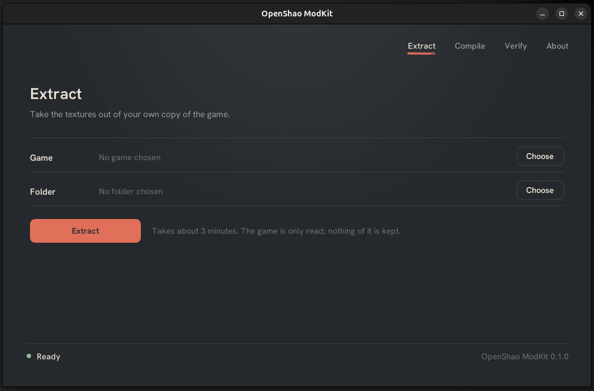
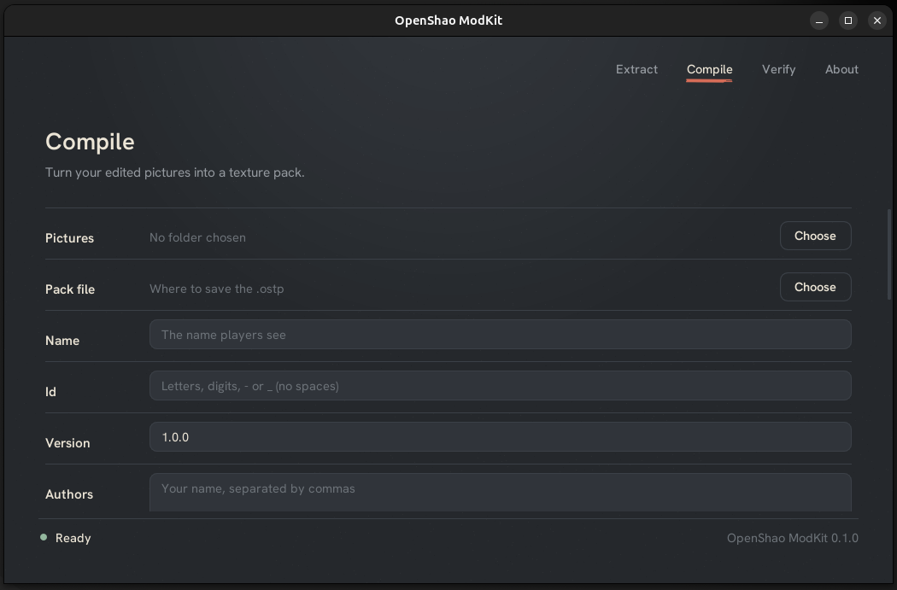
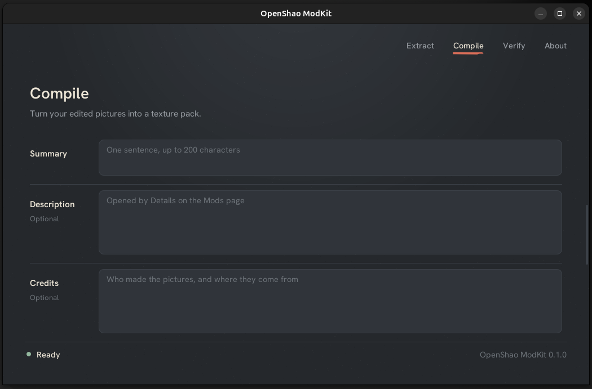
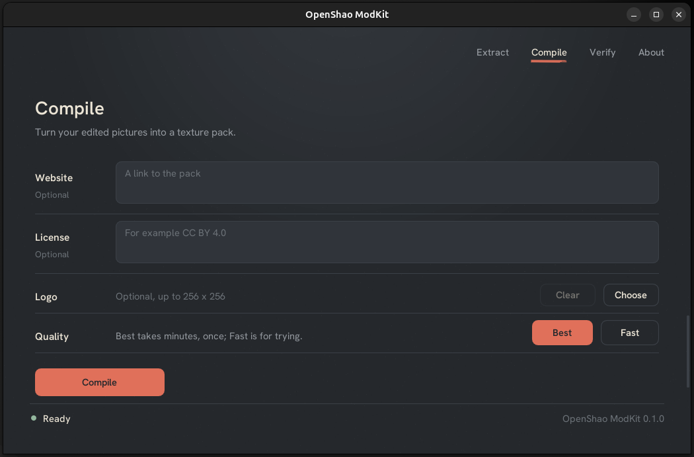

# Making a texture pack for OpenShao

This guide takes you from your copy of the game to a texture pack that anyone can install from OpenShao's Mods page. You need the game's disc image
(or its files), the ModKit, and a way to make pictures: an image editor, an upscaler, a script, your own hands.

A texture pack **replaces the game's textures with larger ones**. Nothing is stored in the game's files: the pictures are read by OpenShao as the
game runs and live only in video memory. Players turn packs on and off, and the original game is never changed.

- [The five steps](#the-five-steps)
- [1. Extract the game's textures](#1-extract-the-games-textures)
- [2. Edit the pictures](#2-edit-the-pictures)
- [3. Try them in the game](#3-try-them-in-the-game)
- [4. Compile the pack](#4-compile-the-pack)
- [5. Install, test and share](#5-install-test-and-share)
- [Making good packs](#making-good-packs)
- [Doing it with scripts or an AI](#doing-it-with-scripts-or-an-ai)

Other guides: [what the game's textures are](TEXTURES.md), [when something goes wrong](TROUBLESHOOTING.md), [automation reference](AUTOMATION.md).

## The five steps

```
 your game  ──extract──▶  a folder of PNG pictures  ──edit──▶  edited pictures
                                  │                                  │
                      try in the game (Developer mode)          compile
                                                                     ▼
                                                            MyPack.ostp  ──▶  OpenShao: Mods ▸ Install from file
```

The ModKit has a window (on Windows, open `OpenShao-ModKit-Windows-x64.exe`; on Linux, extract `OpenShao-ModKit-Linux-x64.tar.gz` and open `OpenShao-ModKit-Linux-x64`) and a command line (`modkit extract`, `modkit compile`, ...; on Linux the same file runs them: `OpenShao-ModKit-Linux-x64 extract ...`); both do the same work. This
guide shows the window first and the command beside it.

**Opening it on Windows for the first time.** `OpenShao-ModKit-Windows-x64.exe` is not code signed, so SmartScreen can stop it once with "Windows protected your PC".
Choose **More info**, then **Run anyway**. [TROUBLESHOOTING](TROUBLESHOOTING.md) has the other cases.

## 1. Extract the game's textures

**Window:** open the **Extract** page, **Choose** the game's disc image (`.iso`) and an empty folder for the pictures, and press **Extract**.
**Command:** `modkit extract "Mortal Kombat - Shaolin Monks.iso" textures`



It takes about three minutes on six cores (about fifteen on one). Nothing is changed in your game and nothing of it is kept anywhere else: the
ModKit reads the game and writes pictures into your folder. A folder with `default.xbe` and the `GAMEDATA.WAD` to `GAMEDATA.WAK` files works in place
of the image.

You get, in the folder:

- **3,333 PNG pictures**, one for each distinct texture in the game, named `<hash>_<format>_<width>x<height>.png`, for example
  `0bac2904604d3ecc_DXT5_256x256.png`. The **hash** is the name OpenShao knows the texture by: **do not rename the files**.
- **`manifest.json`**, which says what each texture is, where it occurs in the game, and holds a signature of its pixels. This is how the tools know
  which pictures you changed. **Keep it in the folder.**

Extract once; you can come back to the same folder as often as you like, and copy it as a backup before a big batch of edits.

## 2. Edit the pictures

Edit the PNG files **in place**, with any program. Only the pictures you change go into your pack. A picture you do not touch stays as the game has it.

The rules for a picture you replace:

| Rule | Why |
| --- | --- |
| **Same proportion** as the original (a 128 x 64 texture becomes 256 x 128, 512 x 256, ...) | the game maps the picture onto the model the same way |
| **Both sides a multiple of 4**, from 4 to 8192 | the graphics card stores textures in blocks of 4 x 4 pixels |
| **Keep the file name** | the name is the texture's identity |

Every texture in the game is a power of two from 8 to 1,024 pixels on a side (most are 64 to 512), so doubling, quadrupling or multiplying by 8 always satisfies the rules.
A picture may be larger than the original (that is the point), and a picture of the original size is allowed too (for a recolour, or a cleaned-up
version at the same size).

**Transparency.** If any pixel of your picture is not fully opaque, the texture is stored with an alpha channel; if all pixels are opaque, it is
stored without one, which takes half the space. Edit the alpha when the original has it and keep it opaque when it does not.

**Format.** Save as **PNG**, 8 bits a channel (RGBA or RGB), and keep the `.png` ending: the game's Developer mode reads only PNG files. The ModKit
reads the pixels, not the metadata, so colour profiles and PNG compression settings do not matter.

You do not make mipmaps (the smaller copies the game uses at a distance): the compiler makes every level for you from your picture.

### What to work on first

There are 3,333 textures but they are not equally important: the ones the player sees large and close (characters, faces, weapons, large walls and
floors) gain the most, and small or rarely drawn ones gain little. [TEXTURES.md](TEXTURES.md) lists how the textures are distributed by size and
what the `manifest.json` knows, which helps you decide, and how to find which textures a place in the game uses.

## 3. Try them in the game

You do not need to build anything to see your pictures in the game.

1. In OpenShao's launcher, open **Files** and turn **Developer** on. A **Developer** page appears.
2. On the Developer page, **Choose** your texture folder (the extraction folder with your edits).
3. **Play.** Restart the game to see a new change.

The game reads your folder as it starts and uses **only the pictures whose pixels changed**: a single changed pixel is enough, and a picture saved
again with the same pixels is not counted. The developer folder is read before any installed texture pack, so you always see what you are editing.
The launcher's Developer page says how many pictures it found, and the game's log says how many it uses.

In this mode nothing is compressed, so a very large number of large pictures may use a lot of video memory; OpenShao keeps the pictures within a
budget (see [Making good packs](#making-good-packs)).

Both renderers, Direct3D 12 and Vulkan, replace textures.

## 4. Compile the pack

Compiling turns the edited pictures into **one file**, `MyPack.ostp`. It is done once, by you, and takes minutes; the player never waits for it.

**Window:** open the **Compile** page and fill in:

| Field | What to write |
| --- | --- |
| **Pictures** | the texture folder |
| **Pack file** | where to save the `.ostp` |
| **Name** | what players see, up to 64 characters |
| **Id** | a short identifier with letters, digits, `-` and `_`, no spaces (up to 80). **It never changes** between versions: OpenShao uses it to know it is the same pack |
| **Version** | three numbers, like `1.0.0`. Raise it when you publish a change |
| **Authors** | names separated by commas |
| **Summary** | one sentence, up to 200 characters |
| **Description** | optional, up to 4,000 characters, and it may have paragraphs (press Enter). The player reads it under **Details** on the Mods page. In the other fields a line break or a tab is turned into a space when you compile, because the game refuses them |
| **Credits** | optional, up to 4,000 characters: who made the pictures and where they come from. Also under **Details** |
| **Website** | optional, a link to the pack (up to 256 characters). Also under **Details** |
| **License** | optional, up to 128 characters, such as `CC BY 4.0`. Also under **Details** |
| **Logo** | optional, a picture up to 256 x 256 (it is shrunk to fit) |
| **Quality** | **Best** is the encoder at its highest level and takes the longest; **Fast** is about ten times faster with a little less quality, for trying |

The page scrolls, and the fields are, in order:







Press **Compile**. A ring shows the progress, with the time left and a **Cancel** button. When it ends, the page says how many textures went in and
how large the pack is, and that it was checked against the format.

**Command:**

```
modkit init textures             # writes textures/pack.json: fill it in
modkit compile textures MyPack.ostp
modkit compile textures MyPack.ostp --encoder rgbcx:10     # fast, to try
```

`pack.json` (the window writes the same file beside your pictures, so the second time everything is filled in, and it keeps any other field you
put there) holds the same fields. Without a description, credits, website or license the pack has no **Details** link on the Mods page:

```json
{
  "id": "MyTextures",
  "name": "My textures",
  "version": "1.0.0",
  "authors": ["Your name"],
  "summary": "What the pack does, in one sentence.",
  "min_recomp": "0.4.1",
  "description": "A longer text, shown when the player opens the pack's details.",
  "credits": "Who made the pictures, and where they come from.",
  "license": "CC BY 4.0",
  "website": "https://example.com/my-textures",
  "logo": "logo.png"
}
```

`min_recomp` is the oldest OpenShao the pack works with; keep `0.4.1` unless you know you need a newer one.

### Textures drawn at once (`preload.txt`)

The game draws a texture before OpenShao has read your picture for it, so its first frames show the original texture and then switch. For a menu
that is a flicker. For the **first picture the game shows**, it can mean the original stays: the game draws that picture for only a few frames and
then stops to load, so a picture that has not been read by then is not seen. To avoid both, list those textures in a file named `preload.txt`
beside your pictures, **one hash per line** (`#` starts a comment); the pack carries the list and OpenShao reads those pictures first. Only hashes
the pack has count.

- [`examples/preload-menus.txt`](../examples/preload-menus.txt) is a list of the textures of the first menu screens, found by playing the game.
- [`examples/preload-boot.txt`](../examples/preload-boot.txt) is the first picture the game shows. Put it in your list as well.

Keep the list to what is drawn at once: each listed picture takes video memory from the start.

### What the compiler does

- It finds **which pictures you edited** by comparing their pixels with the signatures in `manifest.json`. Only those go in.
- It **stops and writes nothing** if a picture cannot be used (it does not open, its proportion is wrong, a side is not a multiple of 4), and says
  which file and why. So does a folder without a usable `manifest.json`: without it the tool cannot tell what you changed, and the whole game would
  go in the pack. If every picture in a folder is yours and the folder has no manifest, `modkit compile --no-manifest` says so.
- It makes **every mip level** from each picture (a Lanczos filter, on premultiplied colour for pictures with transparency, so hidden colour under
  transparent pixels does not bleed into the smaller levels).
- It stores each texture as **BC1** (no transparency, 4 bits a pixel) or **BC3** (transparency, 8 bits a pixel): formats the graphics card reads
  directly, so the game decodes nothing when it plays.
- It **checks the finished file** against the format and only then puts it at the path you gave. A pack that fails, or that you cancel, never
  replaces an existing file.

## 5. Install, test and share

**Install:** in OpenShao, open **Mods** ▸ **Install from file** and choose your `.ostp`. The launcher checks the file, shows your logo, and
**Details** shows your description, credits, website and license. Turn the pack on with its switch; the change applies the next time the game starts.

**Test the finished pack**, not only your pictures: play with it on in the places you edited, with the two quality settings on the Mods page
(**High**, and **Low**, which uses each texture at twice the game's size). A pack that looks good only in the folder and not in the file has
usually lost something in compilation: check the textures that have transparency.

**Share:** the `.ostp` is a single self-contained file. Anyone can install it from the Mods page the same way. When you publish a new version, raise
`version` and keep `id`: players who install the new file are asked to confirm the replacement and see both versions.

Mention in the pack's `credits` where the pictures come from (your own work, a model and its licence, another person's work with their permission),
and put a `license` that says what others may do with it. What you publish is your responsibility: the ModKit stores only what you edited, but the
pictures you make from the game's textures are yours to clear.

## Making good packs

**Size and memory.** Larger pictures cost video memory: a 4x picture has sixteen times the pixels of the original, so it takes sixteen times the memory.
As BC3 (the larger of the two formats), every texture of the game at 4x would take about 4 GB of video memory, and at 2x about 1 GB. OpenShao does not load them all at once: it keeps what is
drawn within a **budget** (60% of the memory the driver says the game may use, or 40% of the largest local memory heap without that information),
and when the budget is full the pictures not drawn for the longest time go first, never one drawn in the last two seconds. A picture that was taken
out is read again when the game draws it. You can make the pack as large as you like, but a very large pack on a card with little memory will read
pictures again often. Good habits:

**Up to 8K, and who can use it.** The format, the game and the ModKit accept pictures up to **8192 pixels on a side** (8K). Since the game's own
textures are at most 1,024 pixels, that is 8x on the largest ones. The memory grows with the pixels: an 8192 x 8192 texture takes about **85 MB** of video
memory as BC3 (64 MB for the top level, a third more for the smaller ones), and every texture of the game at 8x would be around 16 GB. Only graphics cards with a lot
of memory can show many 8K textures at once. A card of 4 GB, such as a GTX 1650, can show a few and no more: the rest of the textures wait to be read again
as the camera moves, and the game may stutter or show the original picture for a moment. Test your pack on a modest card before you publish it, and
tell players what it asks for in the pack's description. Large pictures were checked against the format's limits, but **not measured in the game**: how
far each card goes is not known yet. For most packs 2x and 4x give the best result for the memory they cost.

- Prefer **2x for most textures and 4x only where the player looks**, such as faces and hands. Keep 8K for the few textures where it shows, and say so in the description.
- Do not enlarge what the player cannot see well: tiny, dark, or fast textures.
- The **Low** quality setting makes players with smaller cards use each texture at twice the game's size, whatever your pictures' size, so a pack
  with 4x pictures still helps them, at a quarter of the memory. Low skips the largest levels, so it is the 2x level of your picture that they see: make it good too.

**File size.** The full game at 2x and 4x (4x up to 256 pixels, 2x up to 512) was about 1.5 GB as BC. Players download this, so file size matters:
a pack of the textures that make a visible difference is better than a pack of everything.

**Keeping the look.** The best results keep the original's colours, contrast and style and add detail the original did not have; a result that looks
like a different game is a different mod. Compare in the game, at the real size, not only zoomed in an editor.

**Several packs at once.** Players can enable many packs. When two packs replace the same texture, the one higher in the order on the Mods page wins
(they set the order with Up and Down, and the page says how many textures two packs share). Pack authors need do nothing; replacing the same
textures as another pack is fine, but say so in the description so players know to choose.

**Text in textures.** A texture that has writing in it (menus, signs) is a different texture in each language, with a different hash. A pack made
from one version of the game replaces that version's textures. Whether it also applies when a language pack is on has not been verified.

**Updating a pack.** Keep the texture folder. To release version 1.1.0, change pictures in the same folder, raise the version, compile again to
the same file name, and share the new file.

## Doing it with scripts or an AI

Everything the window does is a Python package, which suits batch work and AI upscalers: `modkit.TextureFolder` lists the textures, finds them by
size and format, reads and replaces pictures, and compiles; the whole flow is under forty lines.
[AUTOMATION.md](AUTOMATION.md) has the reference and `examples/upscale_small_textures.py` is a complete script. Two cautions for automatic
upscaling: keep the transparency channel (many upscalers drop or blur it), and check a sample in the game before running the rest, since
a model that is good on photographs can damage hand-painted or pixel-art textures.
